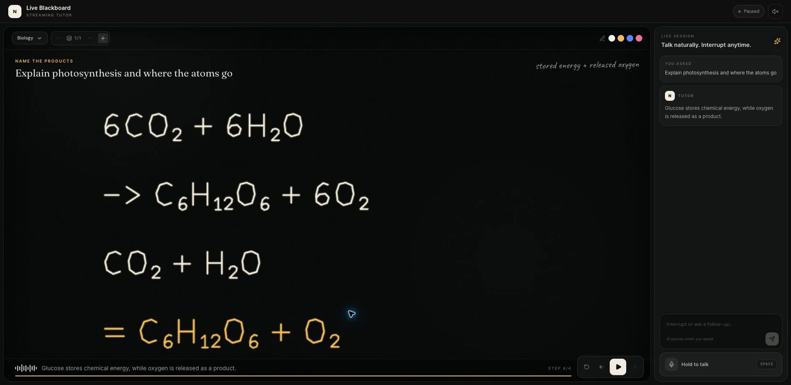
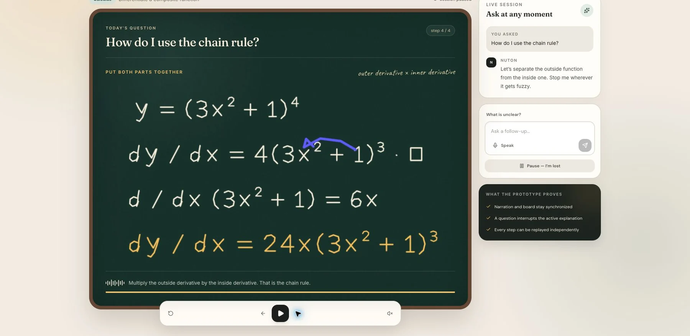
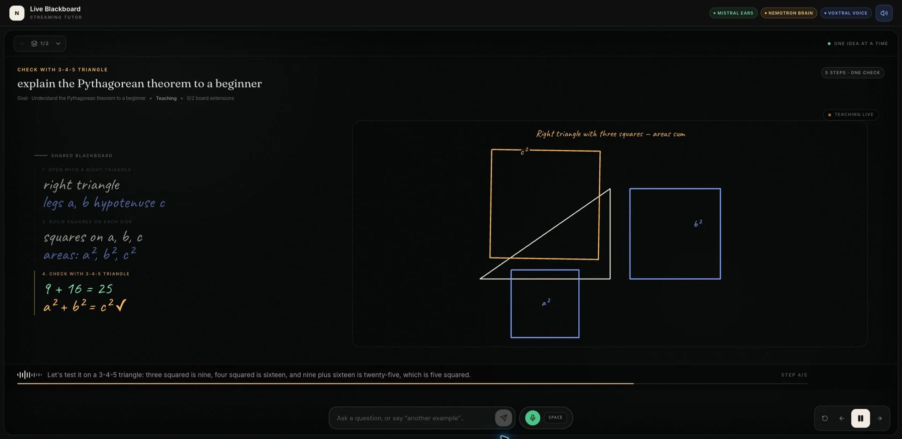
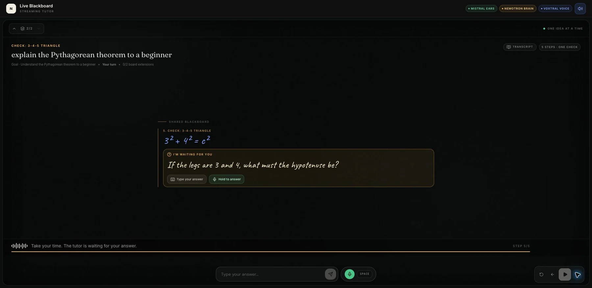
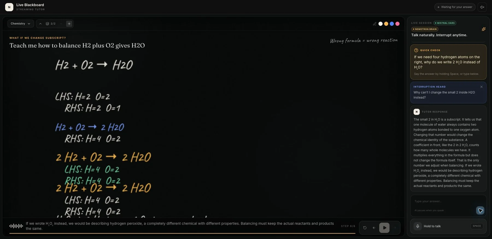

AI Blackboard is a live tutor inside [Nuton](/projects/nuton). You ask a question, and it teaches the answer the way a good teacher at a blackboard would: talking through the idea while it writes and draws, checking that you followed, and stopping when you interrupt. This is how it works and what we learned building it.

*"Explain photosynthesis and where the atoms go." The board builds the equation one transformation at a time, in step with the voice.*

## At a glance

- **Lesson planning:** NVIDIA Nemotron 3 Ultra (served on Baseten) plans the lesson as structured board scenes plus narration.
- **Voice:** Mistral Voxtral for speech output (streamed) and for transcribing what the learner says.
- **Follow-ups:** interruptions and understanding checks are answered by Mistral Large, so they come back fast.
- **The board:** the model decides what to show; a deterministic renderer decides where it goes.
- **Reuse:** the same runtime is embedded in [ExamCruise](/projects/examcruise) through a signed launch, so one tutor serves both products.

## Why a blackboard

Chat is a poor way to learn a derivation. A wall of text shows you the finished answer, not how to get there. A teacher at a board does three things a chat window can't: they reveal one step at a time, they point at the thing they're talking about, and they notice when you're lost. Blackboard tries to do all three.

## How a lesson is made

1. **Understand the request.** A quick classification picks the domain and the kind of idea (a process, a derivation, a comparison, a rule) so the planner starts from a sensible teaching approach.
2. **Plan the lesson.** Nemotron returns a sequence of *frames*: what to say, and which board objects to add, change, or highlight while saying it. Lessons come in quick, full, and deep lengths, at simple, guided, or advanced language levels.
3. **Perform it.** Speech is generated and prefetched ahead of the current frame. Each frame's drawing is timed against its audio, so the stroke appears as the words describing it are spoken.
4. **Check understanding.** After the main sequence, the board asks one question at a meaningful point. Answers are graded as correct, partly correct, or needs support, and the tutor responds to the actual misconception.
5. **Recap and keep.** The full transcript, every board, and the lesson history are saved, so you can replay or revisit any step.

*Worked maths uses a Given / Working / Result layout. Each row carries the reason for the step, so the voice and the board agree.*

## Compose a board, not slides

Our early versions narrated well but used the board badly: a heading on the left, one generic diagram, then the next "slide". The fix was a **semantic board composer** that sits between the plan and the pixels.

- **The model chooses meaning.** It describes objects with stable IDs (a right triangle, a square on each side, an equation row, a cache in a system diagram) and the relationships between them.
- **The renderer owns layout.** Placement, spacing, alignment, and collision handling are deterministic code, not model output. The same plan always draws the same board, which makes it testable.
- **Objects persist within a scene.** A worked solution grows downward without redrawing earlier rows. When the lesson moves to a new idea, the stale scene is cleared, and previous boards stay reachable with back and forward.
- **Layouts match the shape of the idea.** We started with grammars for systems and processes, worked derivations, comparisons, rules with a concrete case, and transformations from one representation to another.

*The Pythagoras scene: notes in the left margin, the triangle and its three squares in the working area, each labelled as the narration reaches it.*

Golden tests cover the parts that used to break: normalising provider output, repairing references to objects that don't exist, deterministic layout, scene resets, and progressive reveals. When a provider returns a whole solution in one frame, it is narrowed to the active step instead of being dumped on the board at once.

## Interruptions

Hold Space and the tutor stops mid-sentence. You can ask by voice or by typing. Blackboard transcribes the question, answers it directly and briefly with the current board as context, and then **returns to the exact beat it paused on**. Teachers get interrupted constantly. A tutor that can't recover from it isn't usable.

*The understanding check is asked on the board itself, and the learner can answer by voice or text.*

## Keeping it fast

The wait that matters is from the learner asking to the first useful thing happening. We measure first ink and first audio separately, because each has a different bottleneck.

- **Stream the plan.** Frames are played as soon as they arrive, and if a provider stream stalls after useful frames, the lesson continues with what it has instead of failing.
- **Prefetch speech.** Audio for upcoming frames is requested while the current one plays. Voxtral streams audio chunks, so playback starts before a sentence is fully synthesised.
- **Use the right model for each job.** The large planner only plans. Interruptions and grading go to a faster model, because a five-second pause after "wait, why?" feels broken.

*Longer derivations page across boards. Earlier pages stay one click away.*

## One runtime, two products

[ExamCruise](/projects/examcruise) students can press **Explain on Blackboard** on any practice question. Copying the code would have forked the voices, pedagogy, and fixes. A plain iframe would have had the wrong login and billing, and no trusted question context. Instead, the ExamCruise backend verifies the learner's entitlement, sends the question, options, the learner's answer, and the verified solution to Blackboard server-to-server, and receives a **one-time launch URL**. The token travels in the URL fragment and is exchanged once. Blackboard never shows the correct answer during a timed paper.

## What I learned

- **Let the model choose meaning and let code choose pixels.** Every board bug we fixed for good was fixed by moving a decision out of the prompt and into the renderer.
- **Latency is a product decision.** Splitting planning from follow-ups did more for perceived speed than any prompt change.
- **Interruption is the feature.** Pausing, answering, and resuming cleanly is what makes it feel like a teacher rather than a video.
- **Embed, don't copy.** A signed launch let a second product reuse the tutor without a second copy of it.
