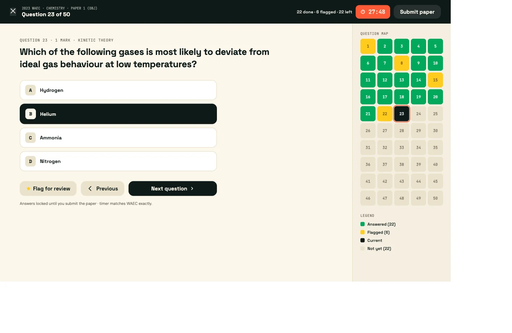
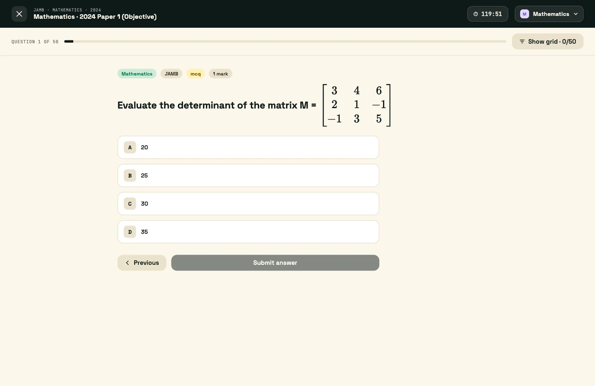
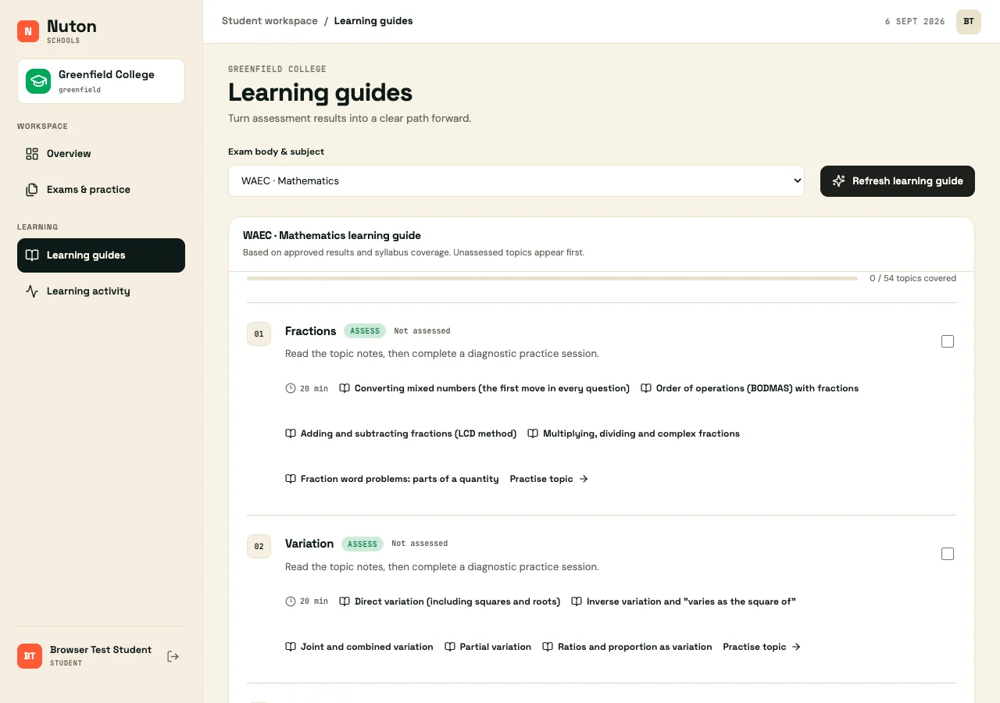

ExamCruise is an exam-prep platform for Nigerian secondary-school students sitting WAEC, NECO, and JAMB. It aggregates real past questions, maps each one to the syllabus topic it tests, and wraps them in a study loop: pick your exam, find your weak topics, revise, practise, then sit full past papers under a real timer. It's a [Nuton](/projects/nuton) product.

## At a glance

- **Corpus:** 44,199 published past questions, each mapped to a syllabus topic, plus 3,045 revision notes and 11,407 flashcards across 639 topics.
- **Study loop:** choose exam → pick subjects → diagnose → study topic by topic → practise → sit timed papers → track mastery.
- **AI help:** questions were mapped to topics with Codex and Claude, and any practice question can be explained live on [AI Blackboard](/projects/ai-blackboard).
- **Stack:** a pnpm and Turborepo monorepo: TanStack Start web app, Expo mobile app, Next.js admin and schools apps, and one Hono + tRPC API that all of them share.

## The problem

Candidates study from scattered PDFs, photocopied past papers, and WhatsApp broadcasts. There's no structured path, no reliable answer key, and no way to tell whether you're ready. Most past-question sites give you papers by year. That's useful for a mock, but it can't tell you that you keep losing marks on stoichiometry.

## One question bank, two ways in

The most important design decision is that there is **one `questions` table** reachable two ways:

- **Past papers** join questions through the paper they appeared in. You sit a whole paper, grouped by year, with a timer and a question palette. Answers and solutions stay locked until you submit.
- **Topic questions** join through the topic. You get a slice of one topic mixed across years, with instant feedback after each question.

A question whose year is unknown still carries a topic, so it appears in topic practice but not in past papers. Theory questions are split into sub-parts (1a, 1b(i)…) stored as child rows, each with its own topic, marks, solution, and marking-scheme points, because the parts of one question often test different topics.

*The paper player: real timer, flag-for-review, and a palette showing answered, flagged, and unseen questions.*

## Mapping 44,000 questions to topics

A question is only useful for revision if you know what it tests. Tagging tens of thousands by hand wasn't realistic, so it became a pipeline:

1. **Build each subject's topic tree** from the syllabus, with stable slugs.
2. **Classify every question** against that tree with an LLM. The model returns structured JSON (topic, verified answer, worked solution, and whether the question needs a diagram), which is validated before it's stored. Codex and Claude workflows did the classification and the study-material generation. A single expansion pass classified 20,886 new questions and nearly doubled the bank, from 23,459 to 44,199. Model session limits paused that run repeatedly, which is why the next step matters.
3. **Ingest idempotently.** Re-running an ingest skips what's already there, so a paused run can always resume by re-reading what's left from the database.
4. **Generate study bundles** (notes and flashcards) for every topic once it has at least ten questions behind it.

One bug is worth remembering: a change to slug generation (`&` became `and`) silently created 105 duplicate topics during an ingest. Merging them back is now a required step after any bulk import.

*Questions render maths properly, and answers stay hidden until the paper is submitted.*

## The study tools

- **Revision notes** per topic, generated from the topic's questions and the syllabus, then reviewed.
- **Flashcards** with spaced repetition (Again / Hard / Good / Easy).
- **A diagnostic** that adapts to your answers and points you at your weakest topics first.
- **Mocks** generated on the same player as real past papers.
- **Explain on Blackboard:** press it on any practice question and [AI Blackboard](/projects/ai-blackboard) teaches that exact question, using its options, your answer, and the verified solution, without you typing anything. It never reveals answers during a timed paper.

## ExamCruise for schools

*Learning guides turn assessment results into a topic-by-topic path for each student.*

Schools get their own app on the same question bank: supervised CBT sessions, theory marking with teacher review, and learning guides generated from each student's results. A background worker handles exam expiry, grading, email, and how long recordings are kept. The schools app reads the shared question bank through a read-only database connection, so a bug in school code can't change the questions.

## How it's built

| Piece | Choice |
| --- | --- |
| Student web | TanStack Start, responsive for mobile web |
| Native app | Expo / React Native |
| Admin and schools | Next.js |
| API | Hono + tRPC, one typed client shared by every app |
| Data | Postgres |
| Auth and payments | Clerk, Paystack |

Every app imports the same typed tRPC client from a shared package. Add a router on the server and the types reach web, mobile, and admin with no code generation and no duplicated request code.

## What I learned

- **Index the same data more than one way.** Papers and topics are two views of one bank, so neither goes stale.
- **Put structured output behind validation.** LLM tagging at this scale only works if every answer is checked before it's stored and every stage can resume.
- **Reuse beats rebuild.** The AI tutor came from Nuton through a signed embed. Building it again inside ExamCruise would have meant two tutors to maintain.
