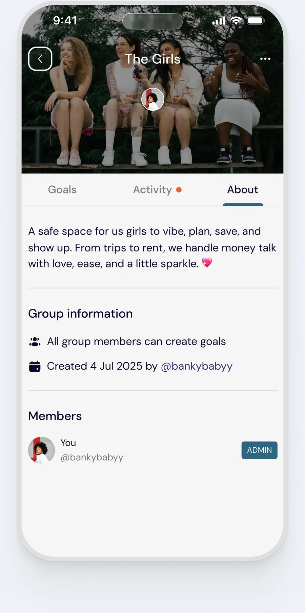
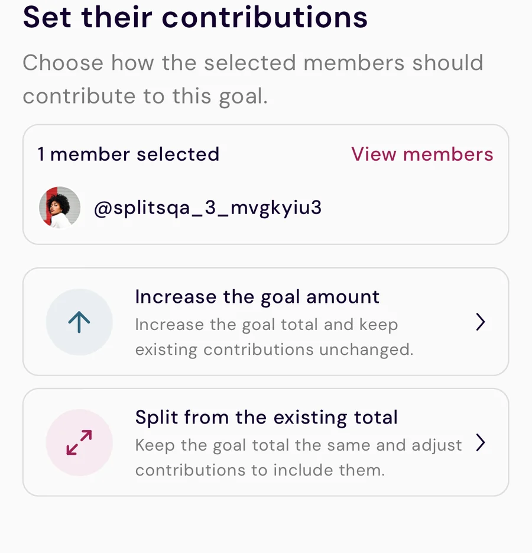

Kova is a better way to manage money together. A group (flatmates, friends planning a trip, an ajo circle) creates a shared wallet, sets a goal, and everyone contributes into it. Everyone sees every contribution in real time, reminders go out automatically, and money only leaves the wallet when the group agrees. I built the iOS and Android app and the [kova.finance](https://www.kova.finance) website.

## At a glance

- **Platforms:** iOS and Android from one Expo / React Native codebase, plus a Next.js marketing site.
- **Core idea:** shared group wallets, with goals, live contribution tracking, automatic reminders, and payouts the group approves.
- **My part:** the mobile app end to end (auth, wallets, groups, goals, payments, notifications, releases) and the website. The app talks to Kova's NestJS backend.
- **Get it:** [App Store](https://apps.apple.com/app/id6760460222) · [Google Play](https://play.google.com/store/apps/details?id=com.kovalabs.kova)

## The problem

Group money in Nigeria usually runs on trust and a spreadsheet: one person collects, everyone else hopes. Rotating savings circles (ajo, esusu) and group trips fall apart over the same questions. Who has paid? Who hasn't? Where is the money? Kova answers all three on everyone's phone, and makes sure no single person can move the money alone.

## What's in the app

- **Groups and goals.** Create a group, invite members, and set goals inside it, from a birthday gift to rent. Each goal shows the total, your share, and what's left.
- **Contribution splits.** When someone joins a goal, the creator chooses to either raise the goal total or re-split the existing total to include them.
- **Pay for me.** A member can ask another to cover their contribution. The payer sees the contribution, the fee, and the wallet debit before entering their PIN, and the payment counts toward the requester's share once it's done.
- **Approvals.** Payouts need the group's consent, so nobody holds or controls the money alone.
- **Wallet.** Add money, send to other Kova users, and view transaction history.
- **Identity and limits.** Tiered verification unlocks higher limits.

## Making money flows safe on a phone

- **Amounts are integers in kobo.** No floating-point naira anywhere between the keypad and the API.
- **Every money action carries an idempotency key.** Retrying after a dropped connection can't charge twice. The app handles "uncertain" network results explicitly instead of assuming failure.
- **Re-check before you pay.** The request and fee preview are fetched again right before PIN entry, so a request that changed or was already settled is caught before money moves.
- **PIN and biometrics.** Payments need a six-digit PIN. Sign-in supports the device's biometrics, and secrets live in the platform's secure storage.

## Notifications and deep links

Push notifications (Firebase Cloud Messaging) and in-app activity items resolve to a route in the app. A signed-out user who taps one signs in and lands where the notification pointed. Account activation emails use universal links (`kova.finance/activate/<token>`), served from the website through Apple's app-site-association file and Android's asset links.

## Shipping updates without the app stores

JavaScript changes ship over the air with EAS Update. The trap: updates are matched to builds by a **runtime fingerprint**, and a mismatch isn't an error. `eas update` succeeds and the update reaches nobody. The same happens if the branch you publish to isn't the one the channel points at, which is how one fix silently went nowhere in August 2026. The release process now runs a preflight that compares the local fingerprint against the newest build on the channel and fails before publishing if they differ.

## Stack

| Area | Choice |
| --- | --- |
| App | Expo, React Native, Expo Router |
| Data | TanStack Query for server state, Redux Toolkit for app state |
| Notifications | Firebase Cloud Messaging, Expo Notifications |
| Security | Expo Local Authentication, Secure Store |
| Releases | EAS Build and EAS Update |
| Monitoring | Sentry, PostHog |
| Website | Next.js on Vercel |

## What I learned

- **Fintech UI is mostly edge cases.** The happy path of "pay for me" is one screen. Changed fees, low balances, wrong PINs, a request settled by someone else, and lost connections are the other ten.
- **Make silent failures loud.** OTA updates and deep links both fail by doing nothing. Each now has a check that fails loudly first.
- **Design for the group.** Every feature is judged by whether it removes a reason for a group chat argument.
