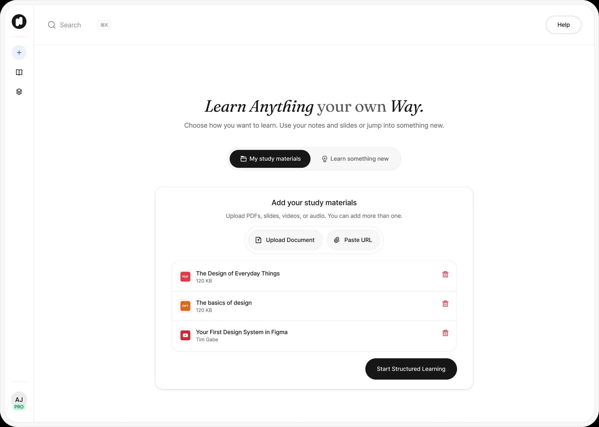
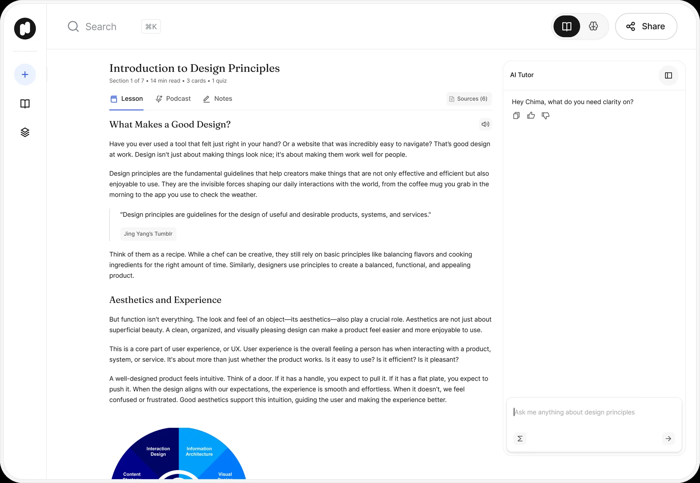
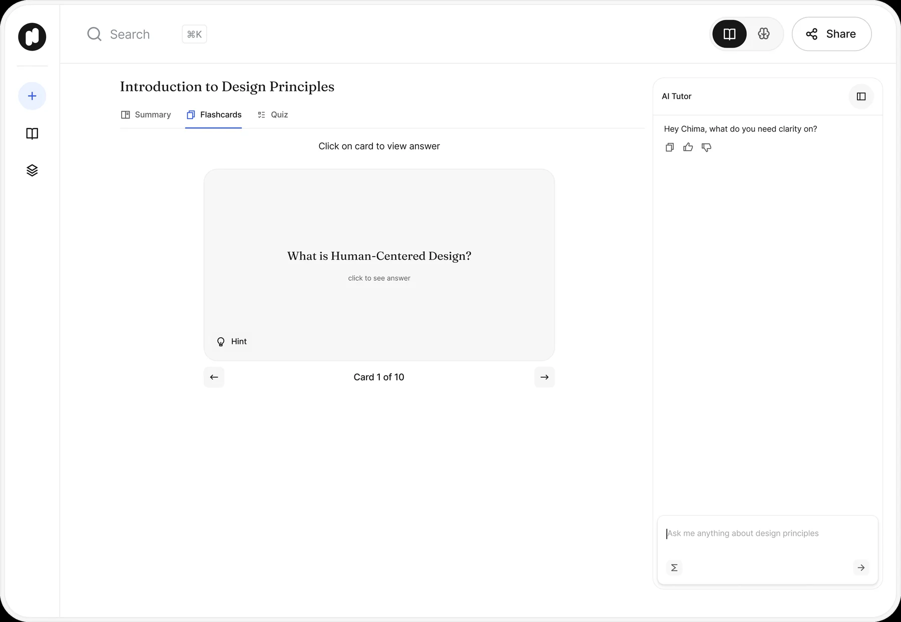
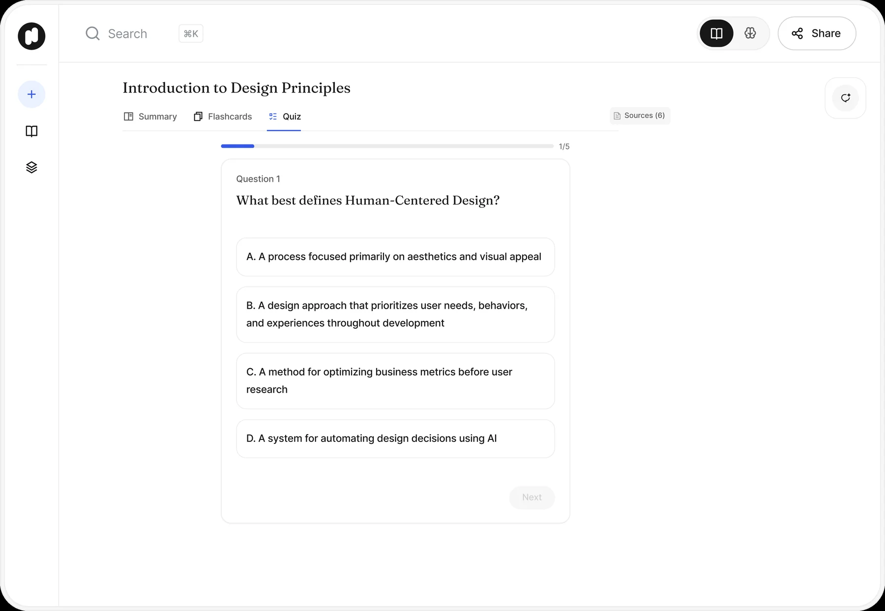
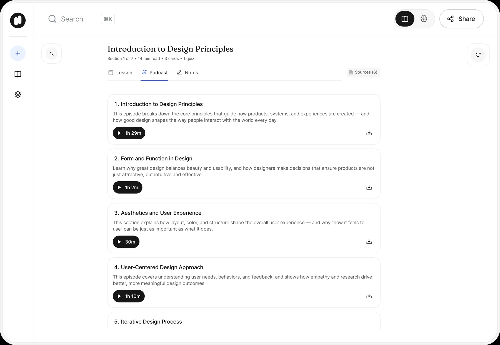

Nuton turns whatever you are studying (a lecture PDF, a slide deck, a YouTube video, a web page, or just a topic you type) into a structured course you can actually finish. Each course comes with an AI tutor, flashcards, quizzes, timed exams, a study guide, and a podcast. This page is a tour of the product and how the web app is put together.

## At a glance

- **What it does:** source material in, finishable course out, with practice built around retention rather than summaries.
- **Who it's for:** university and secondary-school students, and anyone teaching themselves a subject.
- **Where it runs:** [nuton.app](https://nuton.app) on the web, installable as a PWA. Schools use [Nuton for Schools](/projects/nuton-for-schools), and [AI Blackboard](/projects/ai-blackboard) adds a live voice tutor.
- **Under the hood:** a TanStack Start (React 19) web app on top of [Nuton RAG](/projects/nuton-rag), our extraction, retrieval, and generation service.

## Start from your own material

*Upload PDFs, slides, audio, or paste a link. Several sources can go into one course.*

Course creation has two paths. **My study materials** takes uploads and URLs (web pages and YouTube). **Learn something new** takes a topic and researches it first. Generation streams its progress to the browser over Server-Sent Events, so you watch the course take shape (sources read, outline ready, each chapter as it lands) instead of staring at a spinner. The first chapter is readable while later ones are still being written.

## Learn with a tutor beside you

*Every lesson has a tutor that answers from your own sources, not the open web.*

Chapters reveal paragraph by paragraph, with KaTeX for maths and Mermaid or hand-drawn Rough.js diagrams where a picture helps. The AI tutor is grounded in the course's own sources through retrieval, so its answers cite what you uploaded. **Highlight-to-learn** lets you select any sentence and ask Nuton to explain, simplify, give an example, go deeper, connect it to something else, or quiz you on it.

## Practise until it sticks

*Flashcards are generated per chapter and drawn from the source text.*

*Quizzes mix recall, application, and analysis questions, with answer positions balanced.*

Each course generates flashcards, chapter quizzes, and 30- or 50-question timed exams. The quiz rules live in the generation service: questions follow a Bloom's mix (half recall, the rest application and analysis), and no answer letter is allowed to be right more than 40% of the time, so you can't game the quiz by always picking B.

## Listen on the go

*Each chapter becomes a short two-voice podcast episode.*

Podcasts are scripted from the chapter and voiced as a conversation. Text-to-speech runs many turns in parallel, and if the main voice provider runs out of quota partway through, the remaining turns switch to a fallback voice rather than failing the episode. There is also read-aloud with sentence highlighting for reading along.

## Organise and share

**Spaces** group related courses (a module, an exam, a research topic) and give them a shared tutor and space-wide exams. Courses can be shared by link with view analytics, and anyone with the link can fork a copy into their own library. Notes are a Tiptap rich-text editor that sits beside the lesson.

## How the web app is built

| Layer | Choice |
| --- | --- |
| App | TanStack Start (React 19, server rendering), installable PWA |
| Data | Postgres |
| AI backend | [Nuton RAG](/projects/nuton-rag): FastAPI, hybrid search in Qdrant, multi-provider LLM routing |
| Rendering | Streamdown for streamed markdown, KaTeX and MathLive, Mermaid, Rough.js, Tiptap |
| Payments | Stripe internationally, Paystack for Nigeria and the rest of Africa |
| Product analytics | PostHog |

A few decisions shaped the app more than the rest:

- **Stream everything.** Course generation, tutor answers, and chapter text all stream. Most of the perceived speed comes from showing the first useful thing early.
- **Keep the AI work out of the web app.** The front end calls a versioned contract on the RAG service and never talks to model providers directly, so models can change without a front-end deploy.
- **Two payment rails.** Many of our learners pay in naira, and card payments that work in London often fail in Lagos. Paystack and Stripe sit behind one entitlement model, so a feature check doesn't care which one the learner paid with.

## Related write-ups

- [Nuton RAG](/projects/nuton-rag): how documents become grounded courses.
- [AI Blackboard](/projects/ai-blackboard): the live voice tutor that draws while it teaches.
- [Nuton for Schools](/projects/nuton-for-schools): lesson plans and notes for teachers, with approval built in.
