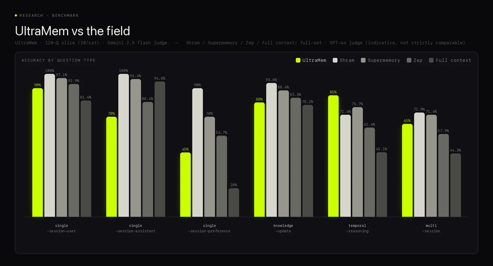

UltraMem is an open-source memory engine for AI agents, written in Rust. It does what a good RAG system does (chunk, embed, retrieve) and the thing RAG can't: it distils durable facts about a user, reconciles them as they change, and answers "what is true *now*?" On a 120-question slice of LongMemEval-S, it went from **50% to 72.5%**, with **85% on temporal reasoning**, and every gain came from memory structure rather than a bigger model.

## At a glance

- **What it is:** a self-hostable memory layer any agent can call over HTTP. Apache-2.0, Rust, Qdrant underneath.
- **Two layers:** a document layer (chunks for "find the thing that says X") and a memory layer (facts for "what do I remember about you?").
- **Time-aware:** a bi-temporal knowledge graph records when a fact was true and when we learned it, so "latest value" is computed, not guessed.
- **Provider-agnostic:** embedder, reranker, OCR, LLM, and vector store are all traits. Swap Jina for OpenAI embeddings with one environment variable.
- **Measured:** 72.5% on LongMemEval-S (120 questions, 20 per category), with the harness in the repo.

## Why memory isn't RAG

RAG is stateless. Every chunk it has ever ingested is equally true, forever. Tell an assistant in March that you run in Adidas and in June that you've switched to Puma, and plain RAG returns both passages. The model has to guess which one is current.

UltraMem adds a second pass over everything it ingests:

```text
distil the document into atomic facts (one batched LLM call)
  → embed each fact
  → find the nearest existing memories
  → classify each new fact: UPDATE / EXTEND / DUPLICATE / NEW
  → supersede old facts (is_latest = false), add edges, or insert
```

The contradiction is resolved **at write time**, not left for the reader to untangle. Ask "which running shoes does the user prefer now?" and only Puma comes back. The Adidas fact is still stored, but it's filtered out of results.

| | Document layer (RAG) | Memory layer |
| --- | --- | --- |
| Unit | Text chunk | Distilled fact |
| State | Stateless, every chunk permanent | Temporal: `is_latest`, `valid_until`, event time |
| Identity | None | Per-namespace (`container_tag`), one pool per user or agent |
| Knowledge update | Old and new chunks both returned | Old fact superseded, only the current one served |
| Standing context | None | A cached profile of what's always true about the user |

`search` returns both layers in parallel, so an agent gets the matching source text *and* the current facts.

## The climb on LongMemEval-S

[LongMemEval](https://arxiv.org/abs/2410.10813) (ICLR 2025) hides each question's evidence inside a ~115k-token, ~50-session chat history and tests six abilities: recalling what the user said, recalling what the assistant said, applying preferences, reporting the latest value of a fact that changed, temporal reasoning, and aggregating across sessions.

Four changes did most of the work:

1. **Round-level chunking and fact-augmented keys.** Conversations were being chunked by paragraph, so answers landed in chunks that didn't match the question. One user-and-assistant round per chunk, with the round's distilled facts added to its embedding key, solved single-session recall.
2. **Event-time extraction.** Facts were stamped with when they were *discussed*, not when they *happened*, which produced answers like "1,258 days". Stamping event dates (`[on 2023-05-20]`, with "last Sunday" resolved against the conversation date) removed the wrong-date errors.
3. **Query decomposition.** "How many days between my MoMA visit and the exhibit?" embeds as one vector that finds one event. Splitting it into a sub-query per event took temporal reasoning from 20% to 80% in the ablation.
4. **Extract, then compute.** The model lists the dated events and Rust does the counting and date arithmetic. Models miscount; code doesn't.

At that point 97.5% of the evidence sessions were being retrieved, yet knowledge-update was stuck at 60%. Better prompts changed 19 of 20 answers and fixed none of them. The old and new values were both in context, with no comparable dates to order them. That's a problem with how the data is represented, and prompting can't fix it.

So we changed the representation. The **bi-temporal knowledge graph** stores each fact as a `(subject, predicate, object)` edge with two clocks: when it was true in the world, and when we learned it. Single-valued states (a personal best, a current city) supersede each other; events (each trip taken) accumulate. Supersession runs in unit-tested Rust over event time. Backfilled over the identical index, so retrieval was unchanged, it moved knowledge-update from **60% to 80%** and the overall score to **72.5%**.

| Stage (120 questions) | Knowledge update | Overall |
| --- | --- | --- |
| Baseline | 60% | 63.3% |
| Type-aware answer prompts | 60% | 66.7% |
| **+ bi-temporal graph** | **80%** | **72.5%** |

## How UltraMem compares

Per-category accuracy next to published LongMemEval figures for other memory systems:


*UltraMem: 120-question slice, Gemini 2.5 Flash judge. Others: full set, GPT-4o judge. Same benchmark, different sample and judge.*

| Category | **UltraMem** | Shram | Supermemory | Zep | Full context |
| --- | --- | --- | --- | --- | --- |
| Single-session (user) | 90% | 100% | 97.1% | 92.9% | 81.4% |
| Single-session (assistant) | 70% | 100% | 96.4% | 80.4% | 94.6% |
| Single-session (preference) | 45% | 90% | 70% | 56.7% | 20% |
| Knowledge update | 80% | 93.6% | 88.4% | 83.3% | 78.2% |
| **Temporal reasoning** | **85%** | 71.4% | 76.7% | 62.4% | 45.1% |
| Multi-session | 65% | 72.9% | 71.4% | 57.9% | 44.3% |

Read this as rough positioning, not a ranking. UltraMem is **mid-pack overall, strongest on temporal reasoning**, competitive on knowledge update, and weakest on recalling what the assistant itself said. That's the next target.

### Compared with other memory systems

The benchmark is one axis. The other is how each system is built and what you can run yourself:

| | UltraMem | Supermemory | Zep / Graphiti | Mem0 | Plain RAG |
| --- | --- | --- | --- | --- | --- |
| Core model | Chunks + reconciled facts + bi-temporal graph | Extracted memories alongside document search | Temporal knowledge graph of entities and relationships | LLM-extracted facts, added, updated, or deleted over time | Chunks only |
| Handles "the latest value" | Yes, computed over event time | Yes, memories that update older ones | Yes, edges carry validity intervals | Yes, updates replace older facts | No |
| Self-host | Yes, one Rust server + Qdrant | Open-source repo, plus a managed API | Graphiti is open source, Zep Cloud is managed | Open source, plus a managed platform | Yes |
| Written in | Rust | TypeScript | Python | Python | — |

Where UltraMem sits:

- **Against Supermemory**, the closest in spirit (UltraMem started as an open alternative to it): the same two-layer idea, with an explicit event-time graph and a fully swappable provider stack you run yourself.
- **Against Zep and Graphiti**, which proved temporal knowledge graphs are the way up the leaderboard: UltraMem uses the same bi-temporal idea but keeps the graph as a third index in the vector store, so there's no separate graph database to operate. The cost is that its graph is entity-*attribute* only for now, so it can't yet count distinct events or traverse multi-hop relationships.
- **Against Mem0**, which also reconciles facts with an LLM: UltraMem adds the time axis, so "what was true in May?" and "what's true now?" are different queries with different answers. Point-in-time ("as of") recall shipped recently.
- **Against plain RAG and long context:** stuffing whole sessions into the prompt *dropped* our score from 63% to 47%. Models lose facts buried in long context ("lost in the middle"). A memory system should be judged on how precise its results are, not how much it returns.

## Lessons that generalise

- **Structure beats scale.** Swapping a mid-tier open model for a frontier one changed the score by less than the noise. Every gain came from how memory was organised.
- **Some errors are representational.** If the data has no comparable dates or countable nodes, no prompt recovers them. Change the data.
- **Measure before you believe.** Run-to-run noise is about ±5 points on volatile categories. One preference score swung from 45% to 70% with no code change. Average several runs before claiming a gain.
- **Publish the failures.** A date-windowed counter we built fired on 0 of 120 questions, because the graph had no event nodes to count. Saying so taught us more than the wins did.

## What's in the repo

- `ultramem-core`: the engine library, provider-agnostic through traits, with unit and live integration tests.
- `ultramem-server`: an axum HTTP API with API-key auth and per-namespace isolation, plus export, audit trail, entity aliases, and point-in-time recall.
- The LongMemEval harness: per-question namespaces, ingest once and evaluate many times, with a flag on every question showing whether the evidence was retrieved.

Next: promote events and entities to graph nodes, which fixes counting and enables multi-hop questions, and an MCP server so agents in Claude, Cursor, and others can use it directly. The full engineering log is in [Structure Beats Scale](https://davak01.substack.com/p/structure-beats-scale-what-ultramem) on Substack.
